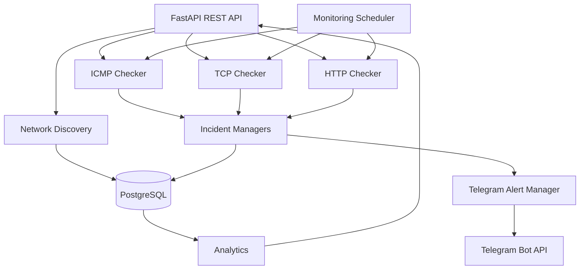

# InfraPulse

Open-source network discovery and infrastructure monitoring platform.


## Overview

InfraPulse is a lightweight infrastructure monitoring platform designed
to discover network devices, monitor service availability, detect
incidents, and deliver real-time Telegram notifications.

The project is built around a modular Python backend, PostgreSQL
storage, and a REST API.

## Features

### Network Discovery

- IPv4 network scanning
- Concurrent ICMP discovery
- MAC address detection on Windows
- MAC vendor identification
- Optional reverse DNS resolution
- Network interface selection
- Persistent scan history

### Infrastructure Monitoring

- ICMP device availability checks
- TCP port monitoring
- HTTP and HTTPS monitoring
- Configurable HTTP status codes
- Configurable connection timeouts
- Automatic monitoring scheduler
- Concurrent monitoring workers
- Persistent check history

### Analytics

- Device availability statistics
- Service availability statistics
- Average, minimum and maximum latency
- Successful and failed checks
- Configurable analytics periods
- Historical monitoring data

### Incident Management

- Automatic device incident detection
- Independent TCP and HTTP service incidents
- Configurable failure thresholds
- Automatic incident resolution
- Active incident deduplication
- Incident history and duration

### Notifications

- Telegram Bot API integration
- Device incident notifications
- Service incident notifications
- Recovery notifications
- Notification delivery after database commit
- Monitoring continues if Telegram delivery fails

## Architecture



## Technology Stack

| Technology | Purpose |
| --- | --- |
| Python 3.14 | Backend |
| FastAPI | REST API |
| Uvicorn | ASGI server |
| PostgreSQL 17 | Persistent storage |
| SQLAlchemy | ORM |
| Alembic | Database migrations |
| Pydantic | Validation and configuration |
| HTTPX | HTTP monitoring and Telegram API |
| Docker Compose | PostgreSQL deployment |
| Pytest | Automated testing |
| GitHub Actions | Continuous integration |

## Project Structure

```text
InfraPulse/
├── app/
│   ├── api/
│   ├── models/
│   ├── repositories/
│   ├── services/
│   ├── config.py
│   ├── database.py
│   └── main.py
├── migrations/
│   └── versions/
├── tests/
├── .github/
│   └── workflows/
├── .env.example
├── compose.yml
├── requirements.txt
├── requirements-dev.txt
└── README.md
```

## Quick Start

### Requirements

- Python 3.14
- Git
- Docker with Docker Compose
- ICMP ping utility
- PostgreSQL provided by Docker Compose

### Installation

```powershell
git clone https://github.com/luciddie/infrapulse.git
cd infrapulse

python -m venv .venv
.\.venv\Scripts\Activate.ps1

python -m pip install -r requirements.txt
Copy-Item .env.example .env
```

Set a strong PostgreSQL password in `.env`
before starting the database.

### Start PostgreSQL

```powershell
docker compose up -d
docker compose ps
```

### Apply Database Migrations

```powershell
python -m alembic upgrade head
python -m alembic check
```

### Start InfraPulse

```powershell
python -m uvicorn app.main:app --reload
```

API documentation:

- Swagger UI: http://127.0.0.1:8000/docs
- OpenAPI: http://127.0.0.1:8000/openapi.json
- Health endpoint: http://127.0.0.1:8000/health

## Configuration

| Variable | Default or example |
| --- | --- |
| POSTGRES_PASSWORD | Set your own password |
| DB_HOST | 127.0.0.1 |
| DB_PORT | 5432 |
| DB_NAME | infrapulse |
| DB_USER | infrapulse |
| MONITORING_ENABLED | false |
| MONITORING_INTERVAL | 60 |
| MONITORING_WORKERS | 4 |
| INCIDENT_FAILURE_THRESHOLD | 3 |
| SERVICE_INCIDENT_FAILURE_THRESHOLD | 3 |
| TELEGRAM_ENABLED | false |
| TELEGRAM_BOT_TOKEN | Optional |
| TELEGRAM_CHAT_ID | Optional |

Automatic monitoring is disabled by default.

Set `MONITORING_ENABLED=true` to enable periodic checks.

To enable Telegram notifications, create a bot using BotFather,
configure its token and chat ID in `.env`, and set
`TELEGRAM_ENABLED=true`.

Never commit the working `.env` file or real credentials.

## API Reference

### System

| Method | Endpoint |
| --- | --- |
| GET | / |
| GET | /health |
| GET | /ready |

### Network Discovery

| Method | Endpoint |
| --- | --- |
| GET | /api/interfaces |
| POST | /api/scan |
| GET | /api/scans |
| GET | /api/scans/{scan_id} |
| GET | /api/scans/{scan_id}/results |

### Devices

| Method | Endpoint |
| --- | --- |
| GET | /api/devices |
| GET | /api/devices/{device_id} |
| POST | /api/devices/{device_id}/check |
| GET | /api/devices/{device_id}/health |
| GET | /api/devices/{device_id}/analytics |

### Services

| Method | Endpoint |
| --- | --- |
| POST | /api/services |
| GET | /api/services |
| GET | /api/services/{service_id} |
| POST | /api/services/{service_id}/check |
| GET | /api/services/{service_id}/checks |
| GET | /api/services/{service_id}/analytics |

### Device Incidents

| Method | Endpoint |
| --- | --- |
| GET | /api/incidents |
| GET | /api/incidents/summary |
| GET | /api/incidents/{incident_id} |

### Service Incidents

| Method | Endpoint |
| --- | --- |
| GET | /api/service-incidents |
| GET | /api/service-incidents/summary |
| GET | /api/service-incidents/{incident_id} |

## Testing

InfraPulse currently includes 120 automated tests (plus Prometheus alert rule tests).

The test suite covers:

- Network scanning and validation
- MAC vendor detection
- REST API
- PostgreSQL repositories
- Transaction rollback
- Device incident lifecycle
- TCP and HTTP checkers
- Service incident lifecycle
- Telegram notification handling
- Notification execution after database commit

Install development dependencies:

```powershell
python -m pip install -r requirements-dev.txt
```

Create a dedicated test database once:

```powershell
docker compose exec postgres createdb -U infrapulse infrapulse_test
```

Run database migrations and tests:

```powershell
$env:DB_NAME = "infrapulse_test"
$env:MONITORING_ENABLED = "false"
$env:TELEGRAM_ENABLED = "false"

try {
    python -m alembic upgrade head
    python -m pytest -v
}
finally {
    Remove-Item Env:DB_NAME
    Remove-Item Env:MONITORING_ENABLED
    Remove-Item Env:TELEGRAM_ENABLED
}
```

Tests reset the dedicated test database tables.
Never run tests against a production database.

Network responses and Telegram delivery are mocked where needed.

## Continuous Integration

GitHub Actions is configured to validate the project on Linux.

The CI pipeline includes:

1. Dependency installation
2. Dependency validation
3. Python syntax validation
4. PostgreSQL startup
5. Database connection verification
6. Alembic migrations
7. Database schema validation
8. Automated tests

## Current Limitations

- Linux network discovery inspects the kernel neighbour cache (`ip -j neigh show`) rather than performing privileged raw-socket ARP scanning; in Docker bridge mode, only L2 neighbours on the container's own bridge subnet are visible.
- Windows `ping_host` does not bind an explicit source IPv4 address (`source_ip` is bound via `ping -I` on Linux only).
- Monitoring scheduler is designed for a single application process (`--workers 1`).
- Device identity is currently based on IP address.
- HTTP monitoring targets must match registered device IPv4 addresses.
- Availability is calculated from observed checks rather than
  continuous uptime.
- Telegram notifications do not yet have a persistent retry queue.
- Authentication and role-based access control are not implemented.
- Service editing and deletion APIs are not implemented.

Run InfraPulse locally or inside a trusted environment.
Do not expose the API publicly without additional security controls.

## Roadmap

- [x] Network discovery
- [x] REST API
- [x] PostgreSQL persistence
- [x] Database migrations
- [x] Device registry
- [x] ICMP monitoring
- [x] TCP monitoring
- [x] HTTP monitoring
- [x] Automatic monitoring scheduler
- [x] Availability analytics
- [x] Device incident management
- [x] Service incident management
- [x] Telegram notifications
- [x] Automated testing
- [x] Continuous integration configuration
- [x] Prometheus metrics exporter
- [x] Grafana dashboards
- [x] Application Docker image
- [x] Full Docker Compose stack
- [ ] Container registry
- [ ] Continuous deployment
- [ ] Infrastructure as Code
- [ ] Web dashboard
- [ ] Authentication and authorization
- [ ] Persistent notification queue

## Project Status

Under active development.

## Observability with Prometheus

InfraPulse exposes application and infrastructure metrics
through a dedicated Prometheus endpoint.

### Features

- ICMP, TCP and HTTP monitoring counters
- Monitoring check duration histograms
- PostgreSQL-backed inventory metrics
- Active device and service incident metrics
- Monitoring scheduler metrics
- Persistent Prometheus time-series storage
- PromQL queries
- Five alerting rules
- Verified application failure and recovery lifecycle

### Start Prometheus

```bash
docker compose up -d prometheus
```

Start the InfraPulse application separately:

```bash
python -m uvicorn app.main:app --reload
```

### Monitoring endpoints

| Component | URL |
|---|---|
| InfraPulse Metrics | http://127.0.0.1:8000/metrics |
| Prometheus | http://127.0.0.1:9090 |
| Prometheus Targets | http://127.0.0.1:9090/targets |
| Prometheus Alerts | http://127.0.0.1:9090/alerts |

### Alerting rules

- InfraPulseDown
- DeviceIncidentDetected
- ServiceIncidentDetected
- HighCheckDuration
- MonitoringSchedulerStalled

### Prometheus configuration

- Version: 3.16.0
- Scrape interval: 15 seconds
- Evaluation interval: 15 seconds
- Storage retention: 15 days
- TSDB retention size: 1 GB
- Persistent Docker volume

### Current limitations

- Monitoring counters reset after application restart.
- Metrics are designed for single-process deployment.
- Database metrics are collected during each scrape.
- Host connectivity configuration targets Docker Desktop.
- Scheduler alerts assume monitoring is enabled.
- Prometheus notification delivery requires Alertmanager.
- Authentication is not implemented.
- Monitoring thresholds require production tuning.
## Grafana Dashboards

InfraPulse provides a provisioned Grafana dashboard
for infrastructure monitoring and observability.

### Features

- Grafana 13.3.2 Docker deployment
- Automatic Prometheus data source provisioning
- Dashboard configuration stored in Git
- Infrastructure Overview with 11 panels
- Real-time application availability
- Device and service inventory metrics
- Monitoring checks per minute
- Average check duration
- P95 and P99 check duration
- Incident visualization
- Monitoring scheduler statistics
- Persistent Grafana storage

### Start Grafana

```bash
docker compose up -d grafana
```

### Access

- Grafana: http://127.0.0.1:3000
- Dashboard: http://127.0.0.1:3000/d/infrapulse-overview

On a fresh installation, sign in using the default
admin credentials and change the password immediately.

### Configuration

Grafana configuration is stored in:

- monitoring/grafana/provisioning/datasources/
- monitoring/grafana/provisioning/dashboards/
- monitoring/grafana/dashboards/

The dashboard is managed as code and automatically
provisioned when Grafana starts.

### Validation

- 10 automated dashboard configuration tests
- Dashboard persistence after container recreation
- Grafana Health API verification
- Prometheus data source integration

### Current limitations

- Metrics are aggregated by monitoring protocol.
- Per-device dashboards are not implemented.
- Registered service counts include disabled services.
- Dashboard configuration is managed through JSON.
- Grafana is exposed only on the local interface.
## Alertmanager and Independent Notifications

InfraPulse integrates Prometheus Alertmanager for
independent infrastructure alert delivery.

### Features

- Alertmanager 0.35.1 Docker deployment
- Prometheus alert routing
- Telegram FIRING and RESOLVED notifications
- Custom notification templates
- Alert grouping and deduplication
- Maintenance silences
- Alert inhibition rules
- Persistent Alertmanager storage
- Optional Telegram integration
- File-based secret management
- Alertmanager self-monitoring

### Standard deployment

Telegram credentials are not required for the
standard monitoring stack.

```bash
docker compose up -d
```

### Telegram-enabled deployment

Configure the Telegram bot token and chat ID in:

- secrets/telegram_bot_token
- secrets/telegram_chat_id

Each file must contain its corresponding value.

The secrets directory is excluded from Git.

Start the Telegram-enabled stack:

```bash
docker compose -f compose.yml -f compose.telegram.yml up -d
```

Always use both Compose files when updating
the Telegram-enabled deployment.

### Notification routing

| Alert | Notification provider |
|---|---|
| InfraPulseDown | Alertmanager |
| MonitoringSchedulerStalled | Alertmanager |
| HighCheckDuration | Alertmanager |
| Device incidents | InfraPulse |
| Service incidents | InfraPulse |

### Monitoring endpoints

- Alertmanager: http://127.0.0.1:9093
- Prometheus: http://127.0.0.1:9090
- Grafana: http://127.0.0.1:3000

### Validation

- 12 automated Alertmanager configuration tests
- Verified FIRING and RESOLVED Telegram delivery
- Prometheus configuration validation
- Alertmanager configuration validation
- Silence lifecycle verification

### Current limitations

- Single-node Alertmanager deployment.
- Telegram requires external API connectivity.
- Local secret files are not encrypted at rest.
- Direct application notifications remain separate.
- Scheduler alerts assume monitoring is enabled.
- Inhibition behavior requires additional runtime testing.
- Updated notification templates require delivery testing.

## Containerization & Docker Compose Deployment

InfraPulse can run as a containerized non-root service (`UID/GID 10001`) alongside PostgreSQL, Prometheus, Grafana, and Alertmanager.

### Prerequisites

- Docker Engine and Docker Compose v2+
- `.env` created from `.env.example` with a strong `POSTGRES_PASSWORD` (note: local `.env` values override Compose interpolation defaults; Compose explicitly sets `DB_HOST=postgres` for `app` and `migrate`)

### Build & Deploy

```bash
docker compose build
docker compose up -d
```

Startup ordering:

1. `postgres` starts and passes `pg_isready`.
2. `migrate` runs `alembic upgrade head` as a one-shot container (`restart: "no"`) using the same `infrapulse:dev` image.
3. `app` starts only after `migrate` exits `0` (`service_completed_successfully`), running Uvicorn with `--workers 1` on `127.0.0.1:8000`.

Monitoring (`MONITORING_ENABLED=false`) and direct Telegram notifications (`TELEGRAM_ENABLED=false`) are disabled by default. Standard deployment does not require `secrets/` or `data/oui.csv`.

For Telegram-enabled Alertmanager notifications:

```bash
docker compose -f compose.yml -f compose.telegram.yml up -d
```

For optional MAC vendor OUI lookup in Docker, mount `data/oui.csv` read-only at `/app/data/oui.csv` once the file is present locally.

### Health & Readiness Endpoints

- `GET /health`: Lightweight HTTP liveness probe (`{"status": "healthy"}`).
- `GET /ready`: Verifies PostgreSQL connectivity (`SELECT 1` with bounded connection, pool, and statement timeouts) and returns `200 {"status": "ready", "database": "connected"}` or sanitized `503`. Note: `/ready` verifies database connectivity, not complete schema/migration compatibility.

### Migrating from Windows Execution to Docker

- **Review `127.0.0.1` monitoring targets**: Existing device and service records pointing to `127.0.0.1` refer to the Windows host when run locally, but refer to the container's own loopback inside Docker.
- **Linux networking & Docker bridge mode**: `ip -j` interface and neighbour discovery work unprivileged on Linux, but Docker bridge containers cannot ARP-discover physical LAN MACs beyond the bridge gateway.
- **Windows source-IP binding**: Explicit `interface_ip` binds ICMP via `ping -I` on Linux; Windows `ping_host` uses the OS routing table.

### Prometheus Rule & Isolated Integration Testing

Validate Prometheus config and alert rules using `promtool`:

```bash
docker run --rm --entrypoint promtool \
  -v "${PWD}/monitoring/prometheus/alerts.yml:/etc/prometheus/alerts.yml:ro" \
  -v "${PWD}/monitoring/prometheus/prometheus.yml:/etc/prometheus/prometheus.yml:ro" \
  -v "${PWD}/tests/prometheus/alerts_test.yml:/etc/prometheus/alerts_test.yml:ro" \
  prom/prometheus:v3.16.0 test rules /etc/prometheus/alerts_test.yml
```

Run isolated integration tests (requires `infrapulse:dev` built first via `docker compose build`):

```powershell
pwsh -NoProfile -File .\scripts\integration\docker_net_test.ps1
pwsh -NoProfile -File .\scripts\integration\compose_e2e.ps1
pwsh -NoProfile -File .\scripts\integration\reliability_test.ps1
```

Integration test isolation guarantees:

- Uses [`compose.integration.yml`](compose.integration.yml) with `internal: true` on `isolated_net` (bridge driver, no host port publishing, no external internet egress).
- Uses literal test-only credentials (`POSTGRES_PASSWORD=integration_test_only_password`) and `INTEGRATION_*` variables so working `.env` values cannot leak into test containers; Telegram is unconditionally disabled.
- Generates unique per-run Compose project/network names and removes only project-owned containers, networks, and temporary volumes in `finally` blocks.
- Limitation: `docker_net_test.ps1`, `compose_e2e.ps1`, and `reliability_test.ps1` target PowerShell (`pwsh`) and Docker Desktop/Engine on the same host where `infrapulse:dev` is built.

### Backup & Rollback

- Take a `pg_dump` backup from `postgres_data` before running schema migrations on production data.
- To roll back the application container to host execution, run `docker compose stop app`, revert `monitoring/prometheus/prometheus.yml` if needed, and run Uvicorn on the host. Use `alembic downgrade -1` only as a controlled manual operation after verifying data compatibility.
